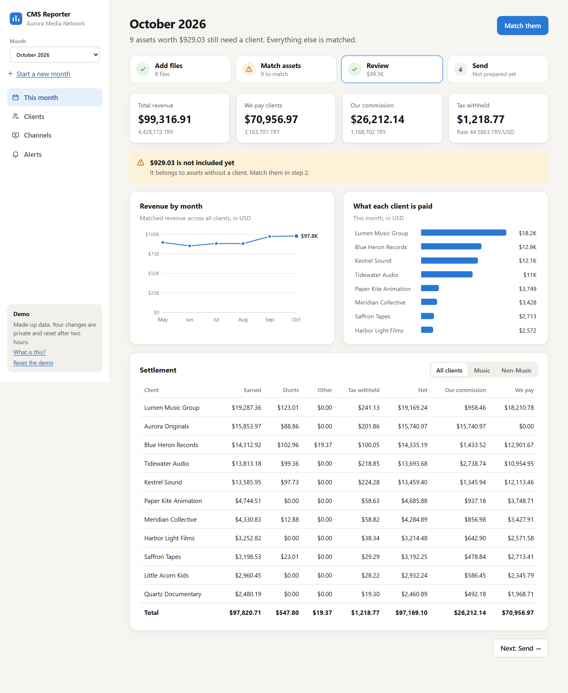
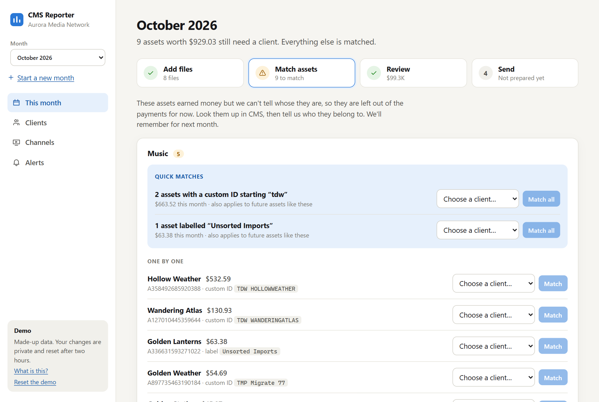
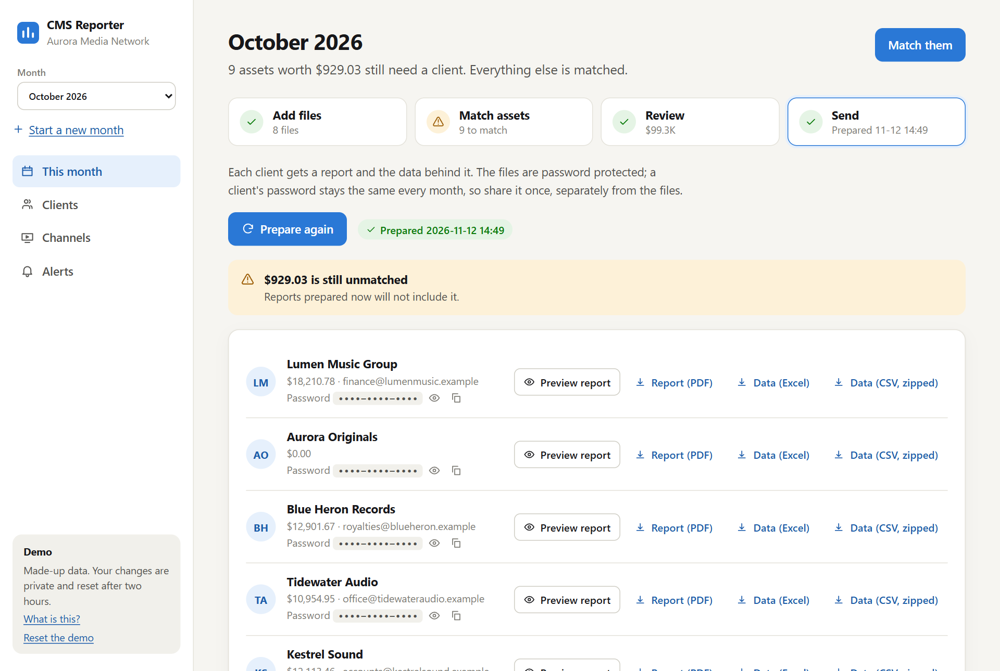
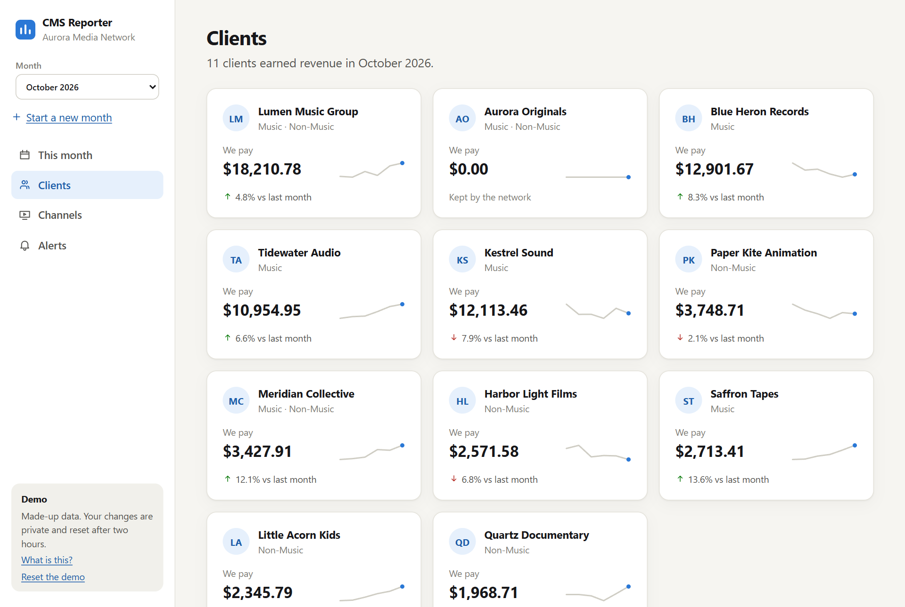
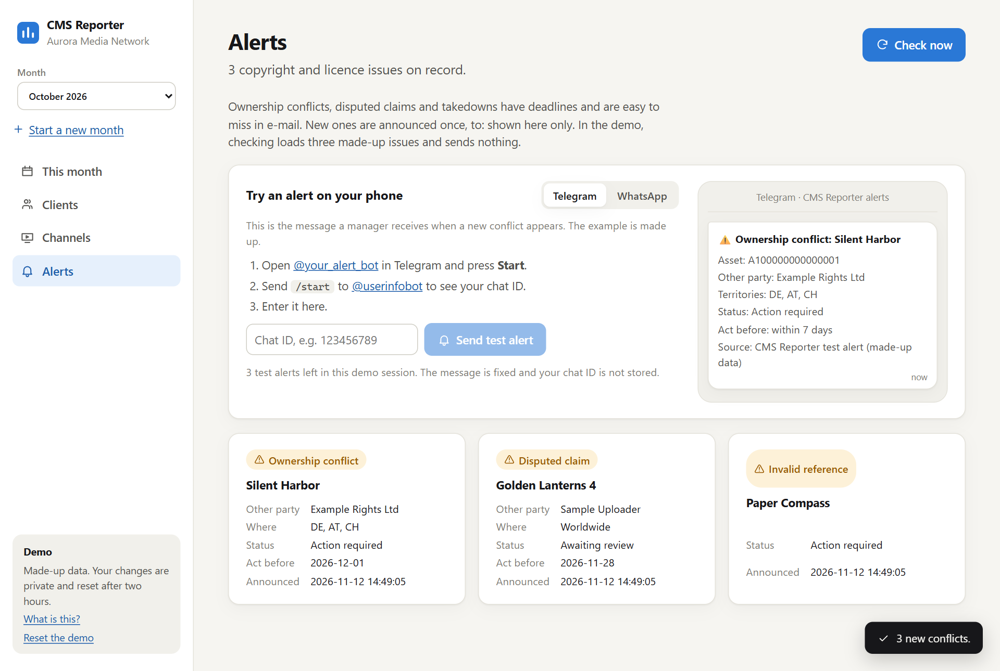
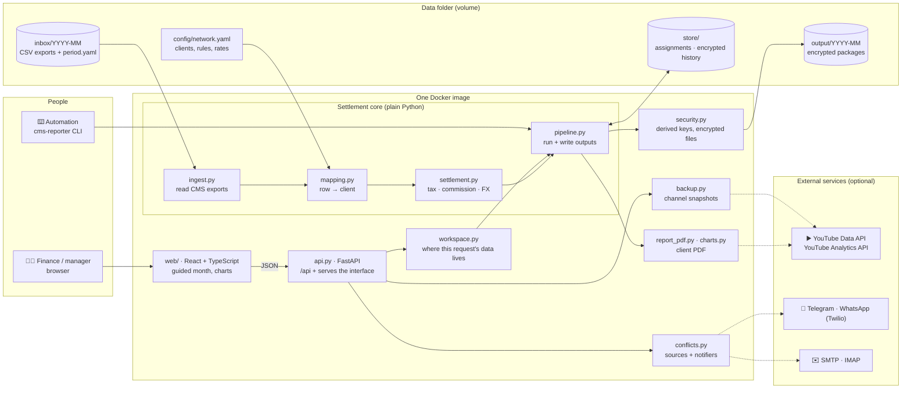
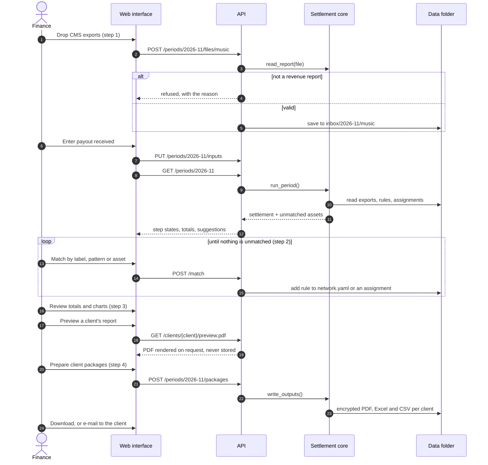
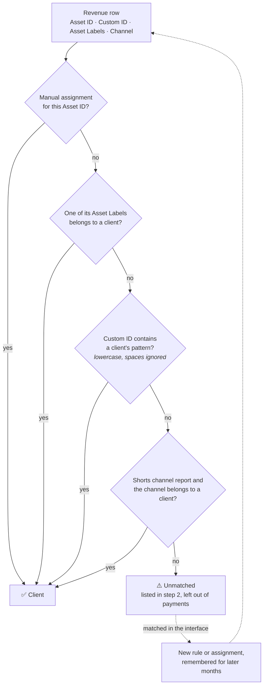
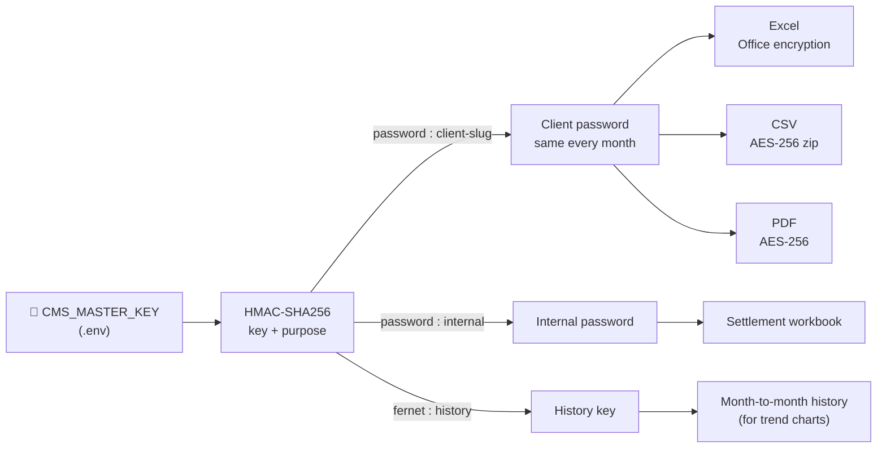
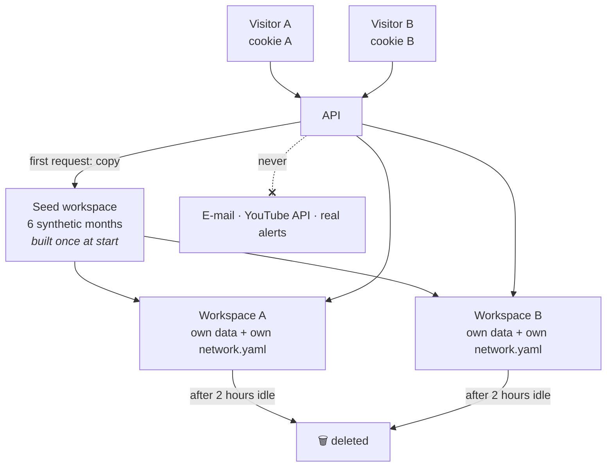

<div align="center">


# YouTube CMS Reporter

**Royalty settlement and client reporting for networks that manage content through YouTube CMS:<br/>multi-channel networks, music labels and other rights holders.**


[](https://render.com/deploy?repo=https://github.com/HikmetEmre/YouTube_CMS_Reporter)

<br/>



</div>

> [!NOTE]
> **All data in this repository is synthetic.** The network, clients, channels, assets and amounts are generated and fictional. This project is not affiliated with or endorsed by YouTube or Google.

---

## Contents

- [Overview](#overview)
- [Features](#features)
- [Screenshots](#screenshots)
- [Architecture](#architecture)
  - [System overview](#system-overview)
  - [The monthly run](#the-monthly-run)
  - [How revenue finds its owner](#how-revenue-finds-its-owner)
  - [Settlement arithmetic](#settlement-arithmetic)
  - [Encryption](#encryption)
  - [Demo mode](#demo-mode)
- [Project structure](#project-structure)
- [Getting started](#getting-started)
- [Configuration](#configuration)
- [Conflict alerts on Telegram and WhatsApp](#conflict-alerts-on-telegram-and-whatsapp)
- [Command line](#command-line)
- [Hosting the demo](#hosting-the-demo)
- [What has not been tested against live services](#what-has-not-been-tested-against-live-services)
- [Development](#development)
- [Licence](#licence)

---

## Overview

Every month a network downloads revenue reports from YouTube CMS, works out which
video or song belongs to which client, takes off tax and its own commission, and
sends each client a statement. Done by hand in spreadsheets, that is slow, and
assets nobody has labelled quietly fall out of the payments.

CMS Reporter turns the month into four guided steps:

1. **Add files.** Drop in the CMS exports exactly as downloaded.
2. **Match assets.** Assets without an owner are listed with their revenue and matched in a click.
3. **Review.** See what each client earned, what is withheld, what the network keeps and what is paid.
4. **Send.** Each client gets a password-protected PDF report and the data behind it.

It is built for the people who actually run the month (a finance colleague or a
manager, not a developer), and everything the interface does is also available from
the command line for automation.

**Live demo:** _add your Render URL here once deployed._ Each visitor gets a private
workspace with six months of made-up data and can upload their own CMS exports,
which are deleted after two hours.

## Features

| Area | Highlights |
|---|---|
| **Guided month** | Four steps with a status on each. The page opens on the step that needs attention and says why in one sentence |
| **File intake** | CMS exports are read as downloaded: title rows above the header are detected, extra columns ignored, per-channel Shorts reports recognised |
| **Asset matching** | By asset label, custom-ID pattern, channel or a manual assignment. Bulk suggestions ("2 assets with a custom ID starting `tdw`"), new clients created on the spot, every match remembered for later months |
| **Settlement** | Withholding tax by country, Shorts revenue shared pro rata, other earnings, per-client commission rates, separate Music and Non-Music rate books, conversion to local currency |
| **Nothing lost** | Matched revenue + unmatched revenue always equals what was loaded. Unmatched money is shown, never dropped |
| **Client reports** | PDF statement with revenue trend, top and lowest earning assets, countries and audience, plus the raw rows as Excel and CSV |
| **Encryption** | Every output is password protected. All passwords derive from one master key and stay the same each month |
| **Channel snapshots** | Dated copies of every channel's metadata, with a list of what changed: the evidence YouTube asks for if a channel is hijacked |
| **Conflict alerts** | Ownership conflicts, disputes and takedowns pushed to Telegram, WhatsApp or e-mail, each announced once |
| **Public demo mode** | Private per-visitor workspaces on synthetic data, with upload limits and automatic clean-up |
| **Interface** | Light and dark themes, phone layout, plain wording ("We pay", "Our commission") |

## Screenshots

| Match assets | Send |
|---|---|
|  |  |
| **Clients** | **Alerts** |
|  |  |

---

## Architecture

### System overview



**Design principles**

- **The settlement is a plain Python package.** The API and the command line are thin layers over the same functions, so anything done in the browser can be scripted and tested without it.
- **One file defines the network.** Clients, matching rules and commission rates live in `config/network.yaml` and nowhere else.
- **Money is never dropped silently.** For every vertical, settled revenue plus unmatched revenue equals loaded revenue. A test enforces it.
- **Nothing financial is written in the clear.** Every output is encrypted, and a test fails if a readable file appears in the output folder.
- **External services sit behind small interfaces with offline stand-ins**, so the whole product runs, and is tested, without any account or API key.

### The monthly run



### How revenue finds its owner

Each revenue row is given to a client by the first rule that matches. Anything left
is reported as unmatched, with what is needed to look it up in CMS.



### Settlement arithmetic

For each client in each vertical (Music, Non-Music):

```
net        = revenue + Shorts share + other earnings - withholding tax
commission = net x the client's commission rate
payment    = net - commission
```

| Term | Meaning |
|---|---|
| **Withholding tax** | A percentage of the revenue earned in a country (10% of US revenue in the sample config) |
| **Shorts share** | Music: one monthly sum, shared between clients in proportion to their revenue. Non-Music: a per-channel Shorts report that flows through as ordinary revenue |
| **Other earnings** | Amounts outside the CMS exports, such as channel-store sales, entered for the month |
| **Commission rate** | Per client and per vertical. The network's own catalogue is a client with a rate of 100% |
| **Local currency** | One monthly rate: stated directly, or derived from the payout actually received |

A client can appear in both verticals with different rates; the statement adds them up.

Rows with zero or negative revenue are ignored, so negative adjustments are not
netted against a client. Change `load_vertical` in `ingest.py` if your contracts say
otherwise.

### Encryption

One master key protects everything. Passwords are derived from it, not stored.



- A client's password stays the same every month, so it only has to be shared once. Share it through a different channel than the files.
- The files open with ordinary desktop software: Excel, a PDF reader, 7-Zip.
- The on-screen report preview is rendered on request and never saved.

Keep the master key safe and backed up. If it is lost, existing files cannot be
opened. If it is changed, every password changes.

### Demo mode

With `CMS_DEMO_MODE=1` the same image becomes a public demo.



Visitors can upload their own CMS exports, add clients and change rules without
seeing each other's data. Uploads are limited to 25 MB per file and 60 MB per
visitor. The only thing a demo can send is the optional, fixed
[test alert](#conflict-alerts-on-telegram-and-whatsapp).

---

## Project structure

```
.
├── src/cms_reporter/
│   ├── config.py            # network config (clients, rules, rates) and paths
│   ├── ingest.py            # read CMS exports, find the header row, normalise
│   ├── mapping.py           # attribute each row to a client
│   ├── settlement.py        # tax, Shorts share, commission, payment, FX
│   ├── pipeline.py          # the monthly run and its encrypted outputs
│   ├── security.py          # master key, derived passwords, encrypted files
│   ├── store.py             # manual assignments, encrypted history
│   ├── report_pdf.py        # the client PDF (ReportLab)
│   ├── charts.py            # report charts (matplotlib)
│   ├── analytics.py         # audience data: demo and YouTube Analytics
│   ├── backup.py            # channel metadata snapshots and change detection
│   ├── conflicts.py         # conflict sources (CSV, IMAP) and notifiers
│   ├── delivery.py          # e-mail client packages
│   ├── synth.py             # synthetic CMS exports for demos and tests
│   ├── workspace.py         # per-visitor workspaces, validated config edits
│   ├── api.py               # FastAPI: /api and the web interface
│   └── cli.py               # cms-reporter command line
├── web/src/
│   ├── Month.tsx            # the guided month: add, match, review, send
│   ├── Pages.tsx            # clients, channels, alerts
│   ├── charts.tsx           # hand-written SVG charts
│   └── api.ts · ui.tsx · main.tsx · styles.css
├── tests/                   # settlement arithmetic, encryption, API, isolation
├── config/network.yaml      # a fictional network (replace with your own)
├── Dockerfile               # multi-stage: Node builds the interface, Python serves it
├── docker-compose.yml       # app, cli and conflict-watcher services
└── render.yaml              # one-click public demo
```

---

## Getting started

You need Docker. Nothing else has to be installed.

```bash
cp .env.example .env
docker compose build
docker compose run --rm cli keygen        # paste the output into .env as CMS_MASTER_KEY
docker compose run --rm cli demo          # six months of synthetic data
docker compose up app                     # open http://localhost:8000
```

Then, each month:

1. **Start a new month** in the sidebar and drop in the CMS exports.
2. Enter the **payout received**, so payments can be converted.
3. **Match** anything listed in step 2.
4. **Review**, **prepare the packages** and send them.

<details>
<summary>What a month looks like on disk</summary>

The interface manages this folder; it is also what the command line reads.

```
data/inbox/2026-11/
  period.yaml            exchange rate or payout, Shorts pool, other earnings
  music/*.csv            CMS exports for the Music vertical
  non_music/*.csv        CMS exports for the Non-Music vertical
```

```yaml
# period.yaml: figures that are not in the CMS exports
period: 2026-11
fx:
  currency: TRY
  payout_local: 4250000.00   # amount received; the effective rate is derived from it
  # rate: 44.59              # or state the rate directly
shorts_pool_usd:
  music: 512.40              # split between clients in proportion to their revenue
other_earnings:
  - producer: Blue Heron Records
    vertical: music
    amount_usd: 19.37
    note: Channel store (e-commerce)
```

</details>

---

## Configuration

**`config/network.yaml`** holds the network's clients: commission rates, custom-ID
patterns, asset labels, channels and contact addresses, per vertical. Matching
assets in the interface adds rules to this file. The one in this repository is a
fictional example; replace it with your own and keep the real one out of version
control.

**`.env`** holds secrets and integration settings. See [`.env.example`](.env.example) for the full list.

| Setting | Needed for |
|---|---|
| `CMS_MASTER_KEY` | Everything. Required |
| `YOUTUBE_API_KEY` | Channel snapshots of real channels |
| `YT_CLIENT_SECRET_FILE`, `YT_CONTENT_OWNER_ID` | Audience charts from the YouTube Analytics API |
| `SMTP_*` | E-mailing client packages and e-mail alerts |
| `TELEGRAM_*`, `TWILIO_*`, `WHATSAPP_TO`, `ALERT_EMAIL_TO` | Conflict alerts |
| `IMAP_*` | Reading YouTube's notification e-mails as a conflict source |
| `CMS_DEMO_MODE` | Public demo instances only |

> [!WARNING]
> The web interface has no login of its own. Compose binds it to `localhost`; put it
> behind your own authentication before exposing a real instance on a network.

---

## Conflict alerts on Telegram and WhatsApp

New ownership conflicts, disputes and takedowns are announced once on every channel
that is configured in `.env`. Conflicts are read from issue exports placed in
`data/conflicts/` and, when `IMAP_*` is set, from YouTube's notification e-mails.

```bash
docker compose run --rm cli conflicts --demo       # try it with a made-up export
docker compose --profile alerts up -d              # check every 15 minutes
```

The **Alerts** page shows the message as it arrives in a chat and has a
**Send test alert** button that delivers a sample alert to a real phone:

- **Telegram:** create a bot with [@BotFather](https://t.me/BotFather) and set
  `TELEGRAM_BOT_TOKEN` (and `TELEGRAM_BOT_USERNAME` so the page can link to it).
  The recipient presses Start in the bot and enters their chat ID.
- **WhatsApp:** set `TWILIO_ACCOUNT_SID`, `TWILIO_AUTH_TOKEN` and
  `TWILIO_WHATSAPP_FROM`. With Twilio's sandbox, also set `TWILIO_SANDBOX_JOIN` to
  the join phrase; recipients send it to the sandbox number once.

This also works on the public demo. It is the only thing the demo sends, and it is
limited: the text is fixed, each visitor gets three sends, and the destination is
not stored. Without the settings above, the page shows the preview only.

---

## Command line

Everything the interface does can be scripted.

| Command | What it does |
|---|---|
| `cms-reporter keygen` | Print a new master key |
| `cms-reporter demo` | Generate synthetic months and run everything on them |
| `cms-reporter serve` | Start the web interface |
| `cms-reporter run 2026-11 [--no-write]` | Settle a month; write the encrypted outputs unless `--no-write` |
| `cms-reporter unidentified 2026-11` | List assets that could not be matched |
| `cms-reporter assign music A123… "Client"` | Match an asset to a client from now on |
| `cms-reporter passwords` | Show the file passwords derived from the master key |
| `cms-reporter deliver 2026-11 [--send]` | E-mail the client packages (a dry run without `--send`) |
| `cms-reporter backup [--demo]` | Snapshot channel metadata |
| `cms-reporter conflicts [--watch]` | Announce new conflicts |

With Docker, prefix a command with `docker compose run --rm cli` and drop `cms-reporter`.

---

## Hosting the demo

[`render.yaml`](render.yaml) deploys the public demo to [Render](https://render.com)'s free plan.
Press the **Deploy to Render** button at the top of this page (or, in Render,
**New > Blueprint** and choose the repository), then **Apply**.

Render builds the Dockerfile, generates a master key and sets `CMS_DEMO_MODE=1`.
The free plan sleeps after a period without visitors, so the first request
afterwards takes up to a minute.

Any host that runs a Docker image works the same way: set `CMS_DEMO_MODE` and
`CMS_MASTER_KEY`, and route traffic to `$PORT` (default 8000).

---

## What has not been tested against live services

The settlement, encryption, reports, API and web interface are covered by tests and
run on synthetic data. The integrations below are implemented but could not be
exercised without real accounts, so expect to adjust them on first use:

- YouTube Analytics API (audience charts)
- YouTube Data API with a real key (the demo uses a stand-in with the same response shape)
- Telegram, Twilio WhatsApp, SMTP and IMAP
- Real CMS issue exports: accepted column names are listed in `CSV_FIELDS` in `conflicts.py`

---

## Development

```bash
python -m venv .venv && . .venv/bin/activate     # Windows: .venv\Scripts\activate
pip install -e ".[dev]"
export CMS_MASTER_KEY=$(cms-reporter keygen)

pytest                                   # all tests
pytest tests/test_core.py -k settlement  # a single test
ruff check . && ruff format .

cd web && npm install && npm run build   # builds the interface into the Python package
cms-reporter demo                        # synthetic data into ./data
cms-reporter serve                       # http://localhost:8000
```

While working on the interface, run `cms-reporter serve` and, in `web/`, `npm run dev`
for hot reload; API calls are proxied to port 8000.

| Layer | Technology |
|---|---|
| Web interface | React, TypeScript, Vite. Charts are hand-written SVG |
| API | FastAPI |
| Settlement and reports | pandas, ReportLab, matplotlib |
| Encryption | Office and PDF AES encryption, AES-256 zip, Fernet, keys derived by HMAC |
| Packaging | One Docker image (multi-stage build), Docker Compose |
| Tests | pytest: settlement arithmetic, encryption, the API, visitor isolation |

---

## Licence

[MIT](LICENSE)
